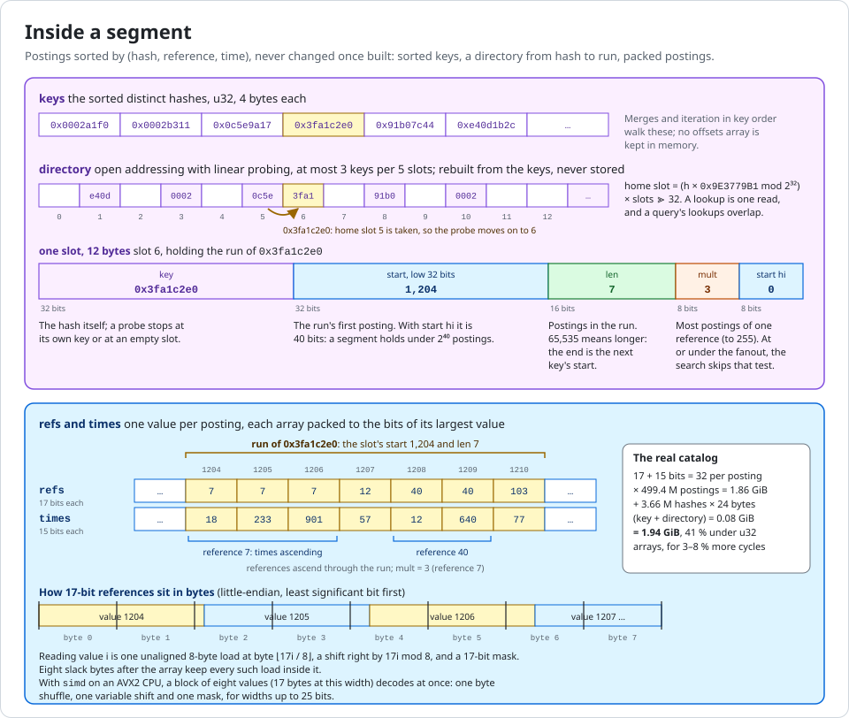
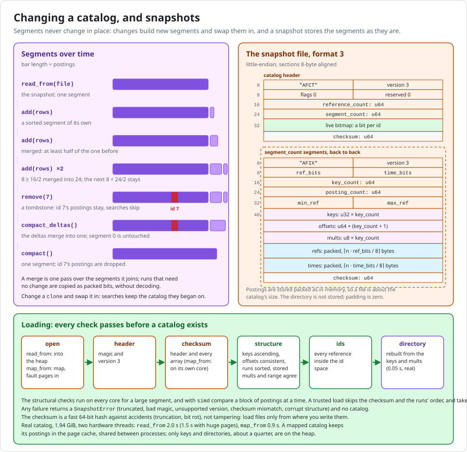

# afpindex

[](https://crates.io/crates/afpindex)
[](https://docs.rs/afpindex)
[](LICENSE)
[](https://github.com/themankindproject/afpindex/actions/workflows/ci.yml)


Exact in-memory inverted index for landmark audio fingerprints: **hundreds of millions of postings**, **exact vote counts**, **sub-millisecond median searches**, **catalogs that change while they serve**, and **snapshots you can map instead of read**.

> **Built for [`audiofp`](https://github.com/themankindproject/audiofp), usable by
> any fingerprinter of the same shape.** afpindex was written as the search
> index for audiofp's landmark fingerprints, but it does not depend on
> audiofp and never touches audio: it indexes rows of `(hash: u32, time:
> u32)`. Any fingerprinter that emits rows like these, with times in a
> unit where a copy's offset stays constant (STFT frames, for example), can
> use it as is: audiofp's Wang or Panako hashes, your own landmarks, or
> another library's. See
> [Feeding the index](docs/USAGE.md#2-feeding-the-index).

## Overview

A landmark fingerprinter (Wang / Shazam-style, Panako, and friends) turns
audio into rows of `(hash, time)`. A **posting** records one occurrence of a
hash in a reference: `(hash, reference, time)`. A copy of a reference keeps
its hashes and shifts their times by one constant, so every query row and
every posting with the same hash cast a **vote** for the bin
`(reference, Δ = time − query_time)`. A true copy piles votes into one bin;
chance collisions scatter single votes everywhere. `afpindex` answers that
search exactly, over hundreds of millions of postings, in milliseconds.

| Piece | What it does |
|-------|--------------|
| **`Catalog`** | References and their postings in immutable, shared segments; `add`, `remove`, `compact` |
| **`Query`** | A clip's rows grouped by hash, keeping the first N times of each |
| **`search`** | Exact vote totals per reference, then a Δ histogram for the references over a vote floor |
| **Snapshots** (`std`) | Checksummed files, read into memory or mapped (`mmap`) |
| **Vector decoding** (`simd`) | AVX2 decoding of packed postings, chosen when a pass starts |

Perfect for:
- Music identification across a whole catalog ("which of 120,000 tracks is this clip, and where in it?")
- Duplicate and re-upload detection at scale
- Rights enforcement against re-encoded copies
- The index behind [`audiofp`](https://crates.io/crates/audiofp)'s Wang hashes once a catalog outgrows an in-memory matcher

## Features

- **Exact Search** - Every posting that should vote does; candidates are deterministic and identical across builds, features and CPUs
- **Count Before Histogram** - A branch-free first pass totals each reference's votes; only references over a vote floor get a histogram, so chance matches never pay for a sort
- **Packed Postings** - Sorted by hash in flat arrays, references and times packed to the width of the largest value: about 4 bytes per posting instead of 8, 1.94 GiB for 499 M postings
- **One Read per Hash** - An open-addressing directory finds a hash's run in one read, and every pass loads its next batch of cache lines before working on the current one
- **Catalogs That Change** - Additions go into small delta segments merged geometrically, on every core for large merges; removals tombstone a reference; ids never change; a clone shares its segments
- **Checksummed Snapshots** - Versioned little-endian files about the size of the catalog, verified (checksum and structure) before use
- **Memory-Mapped Loads** - With `mmap`, the packed postings stay in the file's pages, shared between processes
- **AVX2 Decoding** - With `simd`, eight packed values per block on CPUs that report AVX2 at run time; every other CPU runs the same code as without the feature
- **No Unsafe by Default** - One dependency (`libm`); `mmap` and `simd` bring one `unsafe` block each
- **`no_std + alloc` Core** - Building and searching need only `alloc`

## Installation

```toml
[dependencies]
afpindex = { version = "0.1", features = ["mmap", "simd"] }
```

### Feature Flags

| Feature | Default | Description |
|---------|---------|-------------|
| `std` | Yes | `Catalog` and `Segment` snapshot I/O, `std::error::Error` for `SnapshotError` |
| `mmap` | No | `Catalog::map_from` and `Segment::map_from` (implies `std`; adds `memmap2`) |
| `simd` | No | AVX2 decoding of packed postings on x86-64, chosen at run time (implies `std`; a no-op elsewhere) |

Minimal build (`no_std + alloc`):
```toml
[dependencies]
afpindex = { version = "0.1", default-features = false }
```

`Arc`-shared segments need a target with atomic pointers; elsewhere `Rc`
is used, and the catalog is then not `Send`.

## Quick Start

### Build and search

```rust
use afpindex::{Catalog, Query, Scratch, SearchOptions, vote_floor};

// Build a catalog with one sort over every posting.
let mut builder = Catalog::builder();
for reference in references {                    // your fingerprints
    let id: u32 = builder.add(reference.rows()); // impl IntoIterator<Item = (u32, u32)>
}
let catalog = builder.build();

// Group a query clip's rows by hash, keeping the first 64 times per hash.
let query = Query::from_pairs(clip.rows(), Some(64));
let mut options = SearchOptions::default();
options.min_total_votes = vote_floor(query.input_rows(), 16, 0.02);

// One scratch per thread; the catalog is shared by reference.
let mut scratch = Scratch::new();
for c in catalog.search(&query, &options, &mut scratch)? {
    println!(
        "reference {} at Δ {}: {} votes in the best bin, {} total, noise mean {:.2}",
        c.reference, c.delta, c.votes, c.total_votes, c.noise.mean
    );
}
```

`examples/quickstart.rs` is a runnable version with additions and removals.

### Index audiofp fingerprints

[`audiofp`](https://crates.io/crates/audiofp)'s Wang fingerprinter produces
exactly the rows the index takes, with times in STFT frames (62.5 per
second at 8 kHz):

```rust
use audiofp::{classical::Wang, Fingerprinter, SampleRate};

fn rows(samples_8k_mono: &[f32]) -> Vec<(u32, u32)> {
    let fp = Wang::default().extract(samples_8k_mono, SampleRate::HZ_8000).unwrap();
    fp.hashes.iter().map(|h| (h.hash, h.t_anchor)).collect()
}

let id = builder.add(rows(&track));               // index a track
let query = Query::from_pairs(rows(&clip), Some(64));
// …search as above; a candidate's Δ / 62.5 is where the clip starts, in seconds.
```

`examples/audiofp.rs` runs the whole path and checks the offset it finds.
Fingerprint references and queries with the same `WangConfig`.

### Change a catalog

```rust
let id = catalog.add(rows);       // one sorted delta segment, merged in
catalog.remove(id);               // tombstone: skipped by every later search
catalog.compact_deltas();         // merge the deltas, drop dead postings
catalog.compact();                // one segment for everything
```

`catalog.clone()` is cheap, so a server can compact a clone and swap it in
without blocking the searches running on the original.

### Save and load

```rust
catalog.write_to(std::io::BufWriter::new(std::fs::File::create("catalog.afx")?))?;
let catalog = Catalog::read_from(std::io::BufReader::new(std::fs::File::open("catalog.afx")?))?;
let catalog = Catalog::map_from("catalog.afx")?;   // `mmap` feature
```

A snapshot keeps the id space and the removals, so the next `add` returns
the id it would have returned before.

## Architecture

How rows become candidates, from the whole catalog down to the bits. Each
figure has more detail in [docs/USAGE.md](docs/USAGE.md).


**Inside a segment.** Sorted keys, a directory that finds a hash's run in
one read, and every posting's reference and time packed to the width of
the largest value
([memory](docs/USAGE.md#12-memory), [segments](docs/USAGE.md#14-working-with-segments-directly)).



**A search, pass by pass.** Lookup, a totals pass that counts votes per
reference, survivors over the vote floor, and a histogram of offsets for
those survivors only
([searching](docs/USAGE.md#6-searching), [options](docs/USAGE.md#7-search-options)).


**Changing a catalog, and snapshots.** Additions, removals and compactions
build new segments; a snapshot stores them as they are, and a load checks
everything before a catalog exists
([changing a catalog](docs/USAGE.md#10-changing-a-catalog), [snapshots](docs/USAGE.md#13-snapshots)).



## Documentation

- [docs/USAGE.md](docs/USAGE.md) - the full guide: concepts, feeding the index, reference ids, building, queries, searching and every option, reading candidates, custom scoring, changing a catalog while it serves, threads, memory, snapshots, segments, errors, features, production and troubleshooting
- [docs/PERFORMANCE.md](docs/PERFORMANCE.md) - every measurement, how the passes are arranged, and what was tried and left out
- [API reference](https://docs.rs/afpindex) on docs.rs
- [CHANGELOG.md](CHANGELOG.md)

## Performance

A real catalog, 499.4 M postings from 120,329 production references
(3.66 M distinct hashes) with 104 real clips, on an AWS `m7i-flex.large`
(two hardware threads of one Sapphire Rapids core), `simd` build, five
alternating rounds; candidates were identical in every run:

| | glibc | glibc with huge pages |
|---|---|---|
| memory | 1.94 GiB | 1.94 GiB |
| search, one thread, p50 / p95 | 0.65 / 4.5 ms | 0.60 / 4.3 ms |
| searches per second, two threads | 779 | 795 |
| `read_from` / `map_from` | 2.0 / 0.9 s | 1.5 / 0.9 s |

On an Intel i5-1135G7 laptop, a synthetic catalog of 60 M postings
(20,000 references × 3,000 over 3.6 M distinct hashes) takes 0.31 GiB,
builds in 2.4–2.5 s and answers in 0.10–0.12 ms at the median, 33,000–34,000
searches per second on four threads.

```bash
cargo run --release --example bench -- 20000 3000 3600000 200 4
cargo run --release --features mmap,simd --example lifecycle -- 20000 3000 3600000 2000
```

Building, additions, compaction, loading, the real catalog against the
prototype it replaced, and the allocator comparison are in
[docs/PERFORMANCE.md](docs/PERFORMANCE.md).

## Running in Production

On Linux with glibc, give the heap huge pages:

```bash
GLIBC_TUNABLES=glibc.malloc.hugetlb=1 ./your-service
```

On the real catalog that cut search latency by 7–8 % and `read_from` from
2.0 s to 1.5 s at the same peak memory. It needs transparent huge pages
set to `madvise` (Ubuntu's default) or `always`. Prefer it to swapping the
allocator: mimalloc gave the same search gain, loaded more slowly and
peaked 21–58 % higher. Details in
[docs/USAGE.md](docs/USAGE.md#17-running-in-production).

Drop hashes that appear in nearly every reference (silence, hum) before
indexing or searching: they cost the most and tell the least.

## When to Use It

- **Small sets:** `audiofp`'s own `WangMatcher` and `WangIndex` compare
  fingerprints in memory with nothing to build. By its README a query
  takes about 0.1 ms over 100 tracks and grows with the catalog, and above
  about 10,000 tracks it suggests pre-filters or sharding.
- **A catalog:** `afpindex` is measured at 120,329 references and 499 M
  postings. One search covers every reference exactly, the catalog
  survives restarts as a snapshot, and it changes while it serves.
- **Instead of SQL:** on the 104 real clips, the production ClickHouse
  query agreed on 103. On the last one its `LIMIT 64 BY` keeps an
  arbitrary 64 of a hash's 74 postings, where `afpindex` keeps the first
  64 by time.

## Security

- **Snapshots are checked, not authenticated.** A corrupt or truncated
  file returns a `SnapshotError`; the checksum catches accidents, not
  tampering, so load snapshots only from where you write them.
- **A mapped file must not change.** `map_from` relies on the file staying
  as it was while anything mapped from it is alive: write a new snapshot
  under a new name and rename it over the old one.
- **Searches are bounded.** A search checks its vote totals and the work
  its survivors would cause before building histograms, and returns a
  `SearchError` instead of overflowing or allocating without limit.

## Roadmap

- Release 0.1.0 on crates.io.
- Count by reference range, so each segment's counters fit the fastest
  cache: the measured ceiling is a third off the totals pass.
- Several cores on one heavy query, for the p95.
- A parallel first level of the build sort.
- AVX2's counterpart on aarch64 (NEON), for Graviton hosts.
- References stored as gaps within a run: about a fifth less memory
  (estimated).
- An opt-in faster open for trusted snapshots.
- Sliding-window queries for live audio (`audiofp::StreamingWang`).

## Contributing

```bash
git clone https://github.com/themankindproject/afpindex && cd afpindex
cargo test --all-features
cargo clippy --all-targets --all-features -- -D warnings
cargo fmt --all -- --check
```

CI runs `fmt`, `clippy` and the docs on the latest stable Rust, the tests
on Ubuntu, macOS, Windows and 32-bit x86, `no_std` builds for
`thumbv7em-none-eabi` and `wasm32`, and checks the library on Rust 1.87.
For performance changes, follow
[Reproducing](docs/PERFORMANCE.md#reproducing).

## License

MIT License — see [LICENSE](LICENSE) for details.

## References

- Avery Wang, *An Industrial-Strength Audio Search Algorithm* (ISMIR 2003) — landmark hashes and offset voting
- Joren Six & Marc Leman, *Panako: A Scalable Acoustic Fingerprinting System* (ISMIR 2014) — triplet hashes for the same kind of index
